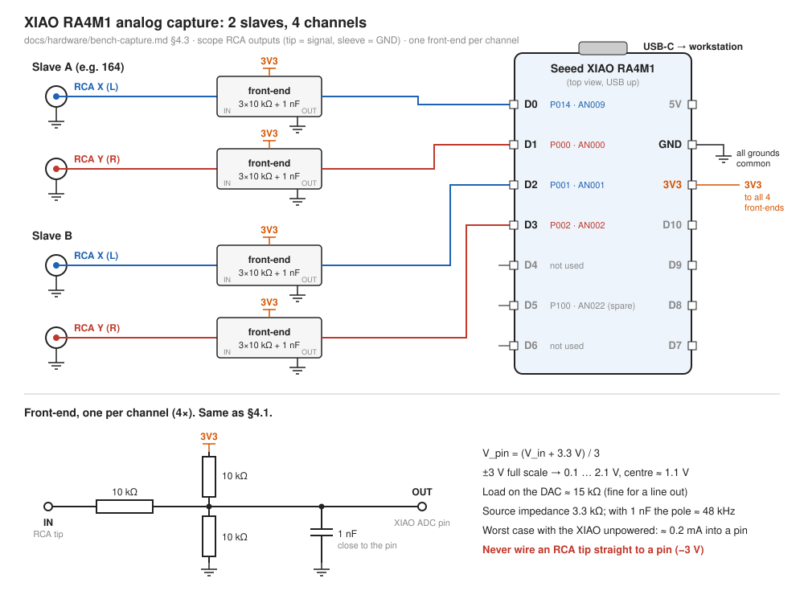
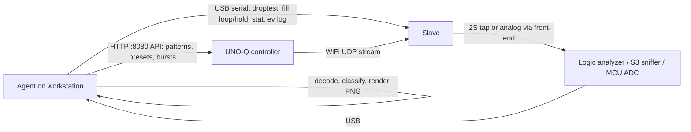

# Bench capture without an oscilloscope

**Status (2026-10-14):** logic analyzer connected and verified (§3); no I2S capture yet, decoder
not written. XIAO RA4M1 analog capture built and verified end to end on slave B's wiring with
the slave powered off (§4.3, §4.4). Inventory in §7.

**Goal:** check what the slaves actually output, without a scope on the bench, and in a way an agent
can run end to end: drive the UNO-Q and the slave, capture the output, decode it, render it, judge it.

## 1. What needs checking

The open scope checks are in [stream-concealment-plan.md](../stream-concealment-plan.md):

| check | source | what to see |
|---|---|---|
| pre-roll shows mic, not centre dot | §3.5 / §3.6 "Scope not checked yet" | from mode change to first play, the output is mic-like, with no frozen point and no (0,0) |
| dots / missing slices under loss | §4.5 `droptest 20`, `fill loop` vs `fill hold` | `loop` gives no constant runs and no gaps; `hold` brings the dots back |
| settle window | §4.5 `droptest 2` + preset changes | hold only within `L + F` of each change |
| slave-to-slave skew | protocol.md §5.2 (±5 ms) | the same pattern change appears on two slaves within ±5 ms |

All of these are **firmware behaviour**. They are decided before the DAC.

## 2. What the slave outputs

From [DESIGN.md](../DESIGN.md) §5–6 and [config.h](../../src/esp32-slave/include/config.h):

- **Digital:** I2S, master on the C3, 48 kHz, 16-bit, stereo (L = X, R = Y), no MCLK.
  - BCK = GPIO4, LRCK = GPIO5, DIN = GPIO6, 3.3 V logic.
  - BCK = 48 kHz × 32 = **1.536 MHz**.
  - Data = **192 KB/s** per slave.
- **Analog:** PCM5102A line out, **ground-centred, DC-coupled, about ±3 V peak** (2.1 V RMS full scale).
- **Gain 1.0 is bit-exact.** `audio_out::write` `memcpy`s the frames into the I2S DMA
  (`audio_out.cpp:86-87`), so the I2S bus carries exactly what the mode manager produced. Below
  1.0 it scales in Q15 instead. **Keep `gain` at 1.0 for digital captures.**

So a **digital tap on BCK/LRCK/DIN covers every check in §1 exactly**. What it can't see is the
DAC's analog stage: amplitude sag at low battery, ringing. The recent changes didn't touch that
stage; one analog channel (§4) covers it when wanted.

## 3. Option A: logic analyzer on the I2S bus (start here)

**Device (verified 2026-10-14):** FX2 clone enumerating as the original Saleae Logic,
USB `0925:3881` ("Lakeview Research Saleae Logic"), high-speed (480M). sigrok sees it as
`fx2lafw - Saleae Logic with 8 channels: D0 D1 D2 D3 D4 D5 D6 D7` and loads
`fx2lafw-saleae-logic.fw` itself.

- The firmware upload re-enumerates the device with a new device number (56 → 57 here), so select
  it with `-d fx2lafw`, not a pinned `conn=bus.dev`.
- Offered sample rates go up to 48 MHz; what USB actually sustains is in the limits table.
- Floating inputs read `1` (raw byte `0xFF`): pull-ups or a buffer on the board. Whether there is
  a 74HC245 is not checked (open the case or look for the chip).

**Why first:**
- No firmware to write.
- Driven entirely from the command line, so it fits a script.
- 8 channels = 2 slaves × 3 lines **on one sample clock**, so skew is measured directly.
- 2 spare channels for markers:
  - the NET LED (GPIO10);
  - or a debug GPIO toggled on firmware events, which lines events up with the output on the
    same timebase, free of USB-serial latency.

**Limits:**

| item | number | consequence |
|---|---|---|
| sample rate | 8–12 MHz needed (5–8× BCK) | **use 12 MHz** (7.8× BCK) |
| sustained rate, measured | 12 MHz: 10 s and 30 s complete. 16 MHz: 10 s complete. 24 MHz: aborts after 18.6 M samples (~0.8 s, `Device only sent 18589184 samples`) | 12 MHz has margin; 16 MHz is the ceiling on this port |
| USB port | measured on root bus 1 shared with the UNO-Q (`2341:0078`, 480M) | sharing with the UNO-Q is fine at 12 MHz; keep other bulk traffic off that bus |
| capture size | 1 byte/sample at ≤ 8 ch: 120 MB per 10 s at 12 MHz (measured), ~720 MB/min | fine for 10–30 s bursts; too heavy for multi-minute soaks (use §5) |
| sigrok's I2S protocol decoder | Python, slow | don't use it on long captures. Save raw binary and decode with numpy (§6) |
| analog | none | digital only, same coverage as §5 |
| input levels | 3.3 V logic; FX2 inputs are 5 V tolerant, a 74HC245 (if present) too | — |

**Setup (done, 2026-10-14):** `sigrok-cli` 0.7.2, `libsigrok` 0.5.2 and
`sigrok-firmware-fx2lafw` are installed; `60-libsigrok.rules` grants USB access, so no `sudo`.

```sh
sigrok-cli --scan             # the two "serial-libsp: invalid parameters" lines are harmless noise
sigrok-cli -d fx2lafw --show  # sample rates, triggers (0 1 r f e)
```

**Wiring, per slave** (tap at the PCM5102A header; short leads):

| slave | BCK (GPIO4) | LRCK (GPIO5) | DIN (GPIO6) | GND |
|---|---|---|---|---|
| A (e.g. 164) | D0 | D1 | D2 | GND |
| B | D3 | D4 | D5 | GND |
| markers | D6, D7 spare | | | |

**Capture:**

```sh
sigrok-cli -d fx2lafw -C D0,D1,D2,D3,D4,D5 --config samplerate=12m --time 10s \
  -O binary -o /tmp/cap.bin
```

The binary output is one raw port byte per sample (bits 6–7 are present even with only D0–D5
enabled). Bit *n* = D*n* is expected but not yet checked against a known signal; check it on the
first real capture (BCK is the only line toggling at 1.536 MHz).

## 4. Option B: analog capture with a spare MCU

This is for the DAC output itself, or as a rough picture if no logic analyzer turns up.

### 4.1 Front-end (required for every MCU ADC)

The PCM5102A swings to about −3 V. Wired straight to a 3.3 V ADC pin, the negative half drives
current through the protection diodes: a clipped picture at best, a stressed pin at worst.
Level-shift each channel with **three equal 10 kΩ resistors** joined at the ADC pin:

- one to the DAC output (X or Y);
- one to 3V3;
- one to GND.

$V_{adc} = (V_s + 3.3)/3$, so ±3 V maps to 0.1–2.1 V, centred at ~1.1 V.

- **DAC load:** ~15 kΩ, fine for a line output, and it can be teed with a real scope later.
- **Optional:** 1 nF from the ADC pin to GND. That is a charge reservoir for the sampling cap, and
  with the 3.3 kΩ source impedance an anti-alias pole near 48 kHz.
- Lowering the slave's `gain` adds margin, but leaves the bit-exact path (§2).

Sample with a **timer-triggered ADC + DMA**, not an `analogRead` loop (its timing jitters).
Stream over USB, never WiFi (§8).

### 4.2 Which board

| board | ADC | fit | verdict |
|---|---|---|---|
| **Seeed XIAO RA4M1** (several on hand) | 14-bit, single ADC unit scanning 2 channels (µs channel skew, irrelevant at audio rates), USB FS | works for the X/Y picture and the analog end-to-end test | **chosen**: several spares, so one can stay wired to the bench. Needs register-level timer-triggered sampling. 2 ch × 48 kSa/s × 2 B = 192 KB/s over USB CDC, well under USB FS, but throughput on the Arduino RA4M1 core is unverified; drop to 24 kSa/s if it falls short |
| Arduino Due (on hand) | SAM3X8E: 12-bit, 1 MSa/s, timer trigger + PDC DMA, native USB **high-speed** port | good; the best USB path of the lot | fallback if RA4M1 USB throughput falls short. Inputs are 3.3 V max, so the §4.1 front-end is still required |
| STM32F103 Blue Pill clone (on hand) | 12-bit, dual-ADC simultaneous mode, USB FS | good on a genuine F103 | skip unless needed: clones often carry a CKS32/CS32 chip whose dual-ADC mode can't be trusted, and many Blue Pills have the wrong USB D+ pull-up (R10) |
| ESP32-S3 (T-Display S3 AMOLED) | `adc_continuous`, noisy, nonlinear near the rails | quick sanity view only | not for measurements |
| ESP32 classic (WROOM-32D, 4 MB) | ADC1 via I2S/DMA, known nonlinear and noisy; USB only through a UART bridge | worse than the S3 | skip |
| ESP32-C3 | ADC1 only, ~83 kSa/s total DMA ceiling | marginal | skip |
| AVR Arduino (Uno/Nano) | 10-bit, ~10 kSa/s | too slow | no |

Rate needed: the circle/Lissajous test patterns and the concealment events (5–20 ms holds, 10 ms
ramps) read fine at 20–48 kSa/s per channel. Full-bandwidth content needs ≥ 48 kSa/s per channel.

### 4.3 XIAO RA4M1 wiring (two slaves on one board)



Taken from the slaves' scope RCA outputs (tip = signal, sleeve = slave GND). Port → ADC channel
checked against the Seeed core's `variants/XIAORA4M1/pinmux.inc`, not just the
[Seeed pin map](https://wiki.seeedstudio.com/getting_started_xiao_ra4m1/):

| signal | front-end → XIAO pin | RA4M1 port | ADC channel |
|---|---|---|---|
| slave A X (DAC L) | D0 / A0 | P014 | AN009 |
| slave A Y (DAC R) | D1 / A1 | P000 | AN000 |
| slave B X (DAC L) | D2 / A2 | P001 | AN001 |
| slave B Y (DAC R) | D3 / A3 | P002 | AN002 |
| divider tops (4×) | 3V3 | — | — |
| divider bottoms, 1 nF caps, all 4 RCA sleeves | GND | — | — |

- **RCA side:** the slave cables end in RCA plugs, so the capture side needs 4 RCA sockets
  (breakout or panel jacks). An RCA Y-splitter keeps a real scope connected too; its 1 MΩ input
  doesn't load the front-end.
- **Ground:** every RCA sleeve goes to XIAO GND. For a slave on battery that is its only ground
  link to the capture; without it the reading floats.
- **P014 is also the RA4M1's DAC0 output.** It only acts as an ADC input while the capture
  firmware leaves DAC0 off.
- **Calibrate per channel, don't trust the nominal 1/3:** the module's ~470 Ω output resistor sits
  in series with the input 10 kΩ, so the gain is ≈ 0.323, not 0.333 (−3 %), and the centre ≈ 1.12 V.
  Resistor tolerance adds more. Take the offset from a centre (0, 0) capture and the gain from a
  known full-scale pattern, cross-checked against the logic-analyzer decode of the same pattern.
- **Unpowered XIAO:** with the slave at −3 V and the XIAO's 3V3 rail down, at most ≈ 0.2 mA flows
  through the 3.3 kΩ source into a pin's clamp diode. Harmless; no power-up order needed.
- **Reading a channel at a glance (14-bit codes):** slave off or RCA unplugged → the 3V3/GND pair
  alone sets the pin to 1.65 V, **code ≈ 8190** (seen on the first capture, 2026-10-14). Slave on
  and centred → ≈ 1.12 V, **code ≈ 5550**. Full scale ±3 V → ≈ 520 … 10570. Measured 2026-10-14,
  slave B on, no mic, quiet room: D2/D3 mean 5570/5585, ±100 codes, 28 LSB rms (the noise floor).
- **Calibration, slave B (id 164) on D2/D3, 2026-10-14.** The test patterns come from the slave's
  local renderer (`renderer_local.cpp`). The controller selects one with
  `curl -XPOST localhost:8080/api/cmd -d '{"ip":"<slave ip>","cmd":{"cmd":"set_pattern","pattern":"square"}}'`
  on the UNO-Q, with slave gain 1.0 (`set_gain`, persisted). The pattern plays while the slave is
  local, and the controller's mode policy keeps it local between burst cycles. Bursts switch it to
  the network stream, so read `cycles.*.next_in` from `/api/state` and capture between them. Restore
  with `"pattern":"mic"`. Model: `code = offset + gain × sample` (16-bit signed sample):

  | channel | offset (code at 0) | gain, ramp ±30000 | gain, square ±24000 | gain, circle 26000 |
  |---|---|---|---|---|
  | X (D2) | 5564 | 0.14533 | 0.14546 | 0.14510 |
  | Y (D3) | 5582 | 0.14657 | 0.14665 | 0.14658 |

  - Nominal is ≈ 0.150 codes/LSB, so the gain is 3 % low, as the 470 Ω predicts. X and Y differ by
    0.8 % (resistor tolerance).
  - **Linear and DC-coupled.** On the 0.2 / 0.13 Hz ramp the residual from a straight line stays
    within ±13 codes over the whole ±30000 range (≤ 0.15 % of span), with no sag.
  - **Clocks.** The circle fits 100.004 Hz, so the XIAO's and the slave's clocks agree within
    ≈ 40 ppm. The ramp fits 0.15 % / 0.06 % fast. This is probably the slave's float32 phase
    accumulator (unverified), so don't use the ramp as a time reference.
  - **X/Y phase** at 100 Hz is 89.66° instead of 90°, about 9 µs between channels. Unexplained,
    and far inside the ±5 ms skew budget.
  - **Square edges** overshoot by ≈ 870 codes on a ≈ 7000-code step (≈ 12 %). That is the
    PCM5102A interpolation filter's ringing (DESIGN §12); the plateaus are flat to 35–45 codes rms.
  - **Polarity is not determined.** All four patterns are symmetric. The logic-analyzer decode of
    the same pattern settles it.
  - **One dropout.** In 16 s of patterns, the 2 s circle had one event 0.567 s in: both channels
    sat at centre for 2.2 ms, then the waveform came back on its original phase. All capture
    flags were clean, so it came from the slave side. Cause unknown. This is the kind of event the
    logic-analyzer A/B checks (§9 item 3) should catch digitally.

**More than one slave per XIAO: yes.** The RA4M1 has a single ADC unit that scans the enabled
channels in turn, so every channel shares one timebase. Between channels of one scan there are only
µs, far inside the ±5 ms skew budget, so two slaves on one XIAO also give an analog skew check.
Two XIAOs don't: separate clocks, no common timebase.

| slaves | analog pins | rate per channel | USB at 16-bit | measured |
|---|---|---|---|---|
| 1 | D2, D3 | 48 kSa/s | 192 KB/s | 5 s, 1000 blocks, 0 gaps, no scan overrun |
| **2** | **D0–D3** | **48 kSa/s** | **384 KB/s** | **v3: 2 × 5 s, 0 gaps, no scan overrun, no late reads. Recommended** |
| 4 | D0–D3, D5 (P100 / AN022), back pads D15 (AN021), D17 (AN020), D18 (AN019) | 24 kSa/s | 384 KB/s | not run; back pads are SMD castellations underneath: solder wires |

Limits, measured 2026-10-14:
1. **USB CDC throughput is CPU-bound, so the sampling ISR's cost comes straight off it.** ≈ 470 KB/s
   ceiling with nothing else running (`--blast 5`). With the 48 kSa/s ISR running alongside
   (`--blast 5 --load`) it was 369 KB/s on v2's ISR (FSP's GPT ISR + callback, from flash, 246
   cycles/sample for the callback alone) and 4 ch at 48 kSa/s (387 KB/s) dropped ~5–7 % of blocks
   in every run. v3 runs a lean ISR from RAM straight off the vector table (149 cycles at 4 ch,
   114 at 2 ch): 449 KB/s loaded, 4 ch clean. 5 ch at 48 kSa/s (480 KB/s) is out of reach.
   Keep the aggregate at ≤ 384 KB/s, and re-run `--blast 5 --load` after any ISR change.
2. **Pins:** 5 analog pins on the front header and 3 more as back pads, so 4 slaves at most.
3. **ADC time:** not a limit. Even a 5-channel scan finished inside the half period (10.4 µs) at
   48 kSa/s: zero scan-overrun flags.
4. **RAM:** the firmware uses a 15.1 KB block ring (8 blocks of 5 ms at 4 ch, 15 at 2 ch). The
   heap and stack take the rest; a full 16 KB ring plus the RAM-resident ISR no longer links.
5. **Noise floor:** ≈ 36 LSB rms per channel with the slave off (≈ 7 mV at the pin, ≈ 22 mV at the
   DAC side, 0.7 % of ±3 V), white plus a 200 Hz line at the block rate (probably the USB bursts
   coupling in; not isolated). Fine for the X/Y picture and the concealment checks; not a
   precision measurement.

### 4.4 Capture tool

- **Firmware:** [`src/bench-capture/xiao_adc/xiao_adc.ino`](../../src/bench-capture/xiao_adc/xiao_adc.ino).
  A GPT timer's compare-match A starts each ADC0 scan through the ELC at mid-period (hardware
  timing, no ISR jitter); the timer's overflow interrupt copies the finished scan into 240-frame
  (5 ms) blocks. Each block has a sequence number, a dropped-block counter and two flags: bit0
  scan overrun (ADC still busy when read), bit1 late read (read after the next scan had started).
  `info` reports `xiao_adc v3`; `stop` replies `stopped isr_avg=… isr_max=… calls=…` (sampling
  ISR cycles since the last `cap`/`mon`), which `xiao_capture.py` prints after each capture.
- **Commands** (text, newline-terminated; full list in the sketch header): `cap <rate> <pins>`,
  `mon <rate> <pins>` (sample without streaming, for the LED), `stop`, `info`,
  `led 2,3` / `led off`, `ledtest <r> <g> <b>`, `wsprobe on|off`, `blast <s> [load]`. A
  `while` in v2's send loop never got back to reading commands at 4 ch / 48 kSa/s, so `stop` was
  ignored; v3 sends one block per `loop()` pass.
- **RGB LED meter** (WS2812 on P112, off at boot): `led 2,3` maps slave B's X swing to red, Y swing
  to blue, beam speed to green, capped at 40/255; a still dot, silence or a powered-off slave stay
  dark (floors: 400 codes of swing, 150 of speed). **It runs only in `mon` and the boot monitor,
  never during `cap`**: v2 drew it during capture with interrupts off for ~6 µs per 4-bit chunk.
  v2 also used a 0-bit high time of 17 cycles; the LED lit full white (every bit read as 1). v3
  uses Adafruit_NeoPixel's RA4M1 timing (12 / 38 / 60 cycles), and `ws_show` keeps ≥ 300 µs low
  between frames: without it two back-to-back frames latch as one and the LED keeps only the
  first (v3's first `ledtest` sent black then the colour, and stayed dark). Verified 2026-10-14:
  a red / green / blue / white `ledtest` cycle shows the right colours. If that ever breaks, `wsprobe on` mirrors the waveform onto D8 (P111, same port write, so same edges)
  for the logic analyzer (spare channel D6, ≥ 24 MHz).
- **Host:** [`src/bench-capture/xiao_capture.py`](../../src/bench-capture/xiao_capture.py) checks
  sequence continuity, saves the 14-bit codes to `.npz`, prints per-channel stats and optionally
  renders an X/Y + time-strip PNG.
- **Soak:** [`src/bench-capture/soak.py`](../../src/bench-capture/soak.py) `run` polls the
  controller's `/api/state` at 1 Hz (every slave's counters and the controller's per-slave
  TX-queue refusals) and records every show burst of one slave (`--node`) on the XIAO;
  `analyze` turns that into one row per burst and slave (loss, EAGAIN %, loop/hold fills,
  resets, underruns, and parked-beam runs for the captured slave).
- **Toolchain:** `arduino-cli` with the Seeed core `Seeeduino:renesas_uno` 1.2.0 (board index
  `https://files.seeedstudio.com/arduino/package_renesas_1.2.0_index.json`). Uploads need a udev
  rule for Seeed's vendor ID; the core's `post_install.sh` only covers Arduino's `2341`:
  `/etc/udev/rules.d/60-seeed-xiao.rules` = `SUBSYSTEMS=="usb", ATTRS{idVendor}=="2886", MODE="0660", TAG+="uaccess"`.

- **Flashing:** plain `arduino-cli upload` fails on this board (`Cannot set alternate interface
  zero: LIBUSB_ERROR_OTHER`, exit 74; the old firmware keeps running). The board definition turns
  the 1200-baud touch off, so dfu-util tries the app's DFU run-time interface. `flash.sh` does the
  1200-baud touch itself (the board comes back as `2886:8049` in ~0.5 s), uploads, then prints
  `info`. Works even when the old firmware is stuck streaming.

```sh
src/bench-capture/flash.sh                                                # compile + flash + info
python3 src/bench-capture/xiao_capture.py --pins 2,3 --seconds 5 --png   # slave B: X = D2, Y = D3
python3 src/bench-capture/xiao_capture.py --blast 5 [--load]              # USB CDC throughput
python3 src/bench-capture/xiao_capture.py --cmd info --cmd "ledtest 40 0 0"
python3 src/bench-capture/soak.py run --minutes 60 --out /tmp/soak1        # one node vs the show cycles
python3 src/bench-capture/soak.py analyze /tmp/soak1
```

## 5. Option C: ESP32-S3 as an I2S sniffer (long captures)

This needs firmware we would write; nothing exists yet.

- **I2S in slave RX mode, inputs only:** it never drives BCK/LRCK.
- **Two slaves per S3:** the S3 has two I2S controllers.
- **Output:** frames with an `esp_timer` timestamp per block, over native USB. 192 KB/s per slave,
  ~60× less data than the logic analyzer.
- **Use it for:**
  - soaks of minutes to hours;
  - rare glitches;
  - whenever the logic analyzer's capture size or USB bandwidth gets in the way.
- **Board requirement:** the S3 board must expose the **native USB** port, not only a UART bridge.
  - **LilyGO T-Display S3 AMOLED** (ESP32-S3R8, 16 MB flash, 8 MB PSRAM) qualifies: its single
    USB-C is the S3's native USB (vendor Arduino settings: "USB CDC On Boot: Enable",
    "USB Mode: CDC and JTAG"). The display uses GPIO 0, 5, 6, 17, 18, 41, 42, 47; the sniffer
    needs 6 other free input pins (3 per slave) from the header. Check the
    [pinout](https://wiki.lilygo.cc/products/t-display-series/t-display-s3-amoled) before wiring.
- **Why not the C3:** one I2S controller (one slave only), and USB-Serial-JTAG throughput for
  192 KB/s sustained is unverified.
- **Why not the classic ESP32 (WROOM-32D):** it has two I2S controllers with slave RX, but no
  native USB. 192 KB/s per slave needs ≥ 1.92 Mbaud sustained through the UART bridge (3.84 Mbaud
  for two slaves). Board bridge chip not checked; most common ones don't reach that.
- **Priority:** low now that the logic analyzer works; only for soaks or rare glitches.

## 6. The closed loop



Both the UNO-Q (USB) and the bench slave (USB serial) already plug into the workstation.
`/tmp/burst_probe.py` (stream-concealment-plan §3.6) already drives the API and reads `[ev]` lines.

**Decoder (numpy, on the raw capture):**
1. Find LRCK edges and sample DIN on BCK rising edges.
2. Rebuild signed 16-bit L/R. I2S (Philips) puts the MSB one BCK after the LRCK edge;
   confirm against the `i2s_std` slot config in `audio_out.cpp`.
3. Cut the stream into 240-frame (5 ms) blocks aligned to the first frame.

**Block classifier:**

| class | signature |
|---|---|
| centre | all frames (0, 0) |
| hold / dot | one constant frame for the whole block or run |
| ramp-to-centre | monotonic glide to (0, 0) over ~10 ms (the concealment ladder) |
| loop-fill | exact repeat of an earlier span of the same capture |
| mic | low-amplitude, aperiodic, uncorrelated X/Y |
| stream | everything else; optionally compared with a reference rendered offline by `PatternGen` |

**Outputs the agent reads:**
- X/Y trace PNGs per window, with a phosphor-style fade (stands in for the phone video in §3.5);
- a time strip of X and Y with block classes and the slave's `[ev]` events overlaid;
- a summary table per test: counts by class, pre-roll content, skew from cross-correlating a
  pattern change on both slaves.

**Before any hardware:** write the decoder first and prove it on a synthetic capture (generated
BCK/LRCK/DIN with known holds and loop-fills), so the first real capture is checked against
something verified.

## 7. Inventory

| item | have? | model / notes |
|---|---|---|
| logic analyzer | **yes, verified** | Saleae Logic clone, `0925:3881`, FX2 / `fx2lafw`, 8 ch; 12 MHz sustained (§3). 74HC245 buffer unknown; irrelevant for 3.3 V I2S |
| ESP32-S3 boards | yes | LilyGO T-Display S3 AMOLED; native USB on the USB-C (§5) |
| ESP32 classic | yes | ESP32-WROOM-32D, 4 MB flash; UART bridge only |
| ESP32-C3 boards | yes | SuperMini? |
| RA4M1 boards | yes, several | Seeed XIAO RA4M1 |
| STM32 boards | yes | STM32F103 Blue Pill clone (chip unknown, §4.2) |
| other Arduino boards | yes | Arduino Due |
| 10 kΩ resistors, 1 nF caps | yes | for §4.1 |
| jumper wires | ? | short leads for the I2S tap |
| second slave on the bench | yes | for the skew check (§3 wiring, D3–D5) |

## 8. What won't work, or misleads

- **Raw DAC output into an MCU ADC:** the negative half clips and stresses the pin. Use §4.1.
- **Sending captures over WiFi:** shares 2.4 GHz with the stream under test and changes the very
  loss being measured. USB only.
- **Having the slave report its own output** (dumping I2S buffers over serial):
  - costs time in the single-core C3's 5 ms audio budget;
  - shares the serial link with the `[ev]` log;
  - doesn't prove what's on the wire.
- **Driving the I2S lines from a sniffer:** the capture side is inputs only, plus shared GND.
  Never tie 3V3 rails together.
- **Slave power rule:** the [README](../../README.md) rule applies. Battery switch OFF while the
  slave's USB-C is plugged in.
- **PC line-in:** AC-coupled, so holds and dots droop. This workstation also has no stereo line-in
  (only EarPods, mono mic).
- **`gain` ≠ 1.0 for digital captures:** the Q15 scaling breaks bit-exact comparison (§2).
- **Using the UNO-Q's own MCU as the capture device:** it is the system under test, and the
  MCU↔Linux bridge is the bottleneck. Not worth it.

## 9. Next steps

1. ~~Fill in §7~~ done; logic analyzer verified (§3). Only open: jumper wires.
2. Write the numpy I2S decoder, classifier and renderer; prove them on a synthetic capture.
3. Logic analyzer on 164: run the §3.5 pre-roll check and the §4.5 `droptest`/`fill` A/B. Then
   add a second slave for skew.
4. XIAO RA4M1 analog channel (§4.3, §4.4) as the end-to-end check through the DAC stage: same
   test patterns, compared against the digital capture (Due as fallback). Slave B calibrated with
   its local square / ramp / circle (§4.3); next: the same patterns on the logic analyzer for
   polarity and a digital-vs-analog comparison.
5. Only if needed: the S3 sniffer (§5) for soaks.
