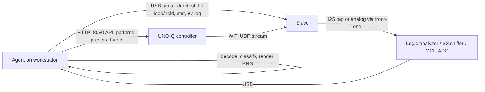

# Bench capture without an oscilloscope

**Status:** plan only, nothing built or bought (2026-10-14). The spare-hardware inventory (§7) still
has to be filled in at home.

**Goal:** check what the slaves actually output, without a scope on the bench, and in a way an agent
can run end to end: drive the UNO-Q and the slave, capture the output, decode it, render it, judge it.

## 1. What needs checking

The open scope checks are in [stream-concealment-plan.md](../stream-concealment-plan.md):

| check | source | what to see |
|---|---|---|
| pre-roll shows mic, not centre dot | §3.5 / §3.6 "Scope not checked yet" | from mode change to first play, the output is mic-like, with no frozen point and no (0,0) |
| dots / missing slices under loss | §4.5 `droptest 20`, `fill loop` vs `fill hold` | `loop` gives no constant runs and no gaps; `hold` brings the dots back |
| settle window | §4.5 `droptest 2` + preset changes | hold only within `L + F` of each change |
| slave-to-slave skew | protocol.md §5.2 (±5 ms) | the same pattern change appears on two slaves within ±5 ms |

All of these are **firmware behaviour**. They are decided before the DAC.

## 2. What the slave outputs

From [DESIGN.md](../DESIGN.md) §5–6 and [config.h](../../src/esp32-slave/include/config.h):

- **Digital:** I2S, master on the C3, 48 kHz, 16-bit, stereo (L = X, R = Y), no MCLK.
  - BCK = GPIO4, LRCK = GPIO5, DIN = GPIO6, 3.3 V logic.
  - BCK = 48 kHz × 32 = **1.536 MHz**.
  - Data = **192 KB/s** per slave.
- **Analog:** PCM5102A line out, **ground-centred, DC-coupled, about ±3 V peak** (2.1 V RMS full scale).
- **Gain 1.0 is bit-exact.** `audio_out::write` `memcpy`s the frames into the I2S DMA
  (`audio_out.cpp:86-87`), so the I2S bus carries exactly what the mode manager produced. Below
  1.0 it scales in Q15 instead. **Keep `gain` at 1.0 for digital captures.**

So a **digital tap on BCK/LRCK/DIN covers every check in §1 exactly**. What it can't see is the
DAC's analog stage: amplitude sag at low battery, ringing. The recent changes didn't touch that
stage; one analog channel (§4) covers it when wanted.

## 3. Option A: logic analyzer on the I2S bus (start here)

Probably a cheap FX2/CY7C68013A "24 MHz 8CH" clone; confirm the model at home. sigrok drives it
with the `fx2lafw` driver.

**Why first:**
- No firmware to write.
- Driven entirely from the command line, so it fits a script.
- 8 channels = 2 slaves × 3 lines **on one sample clock**, so skew is measured directly.
- 2 spare channels for markers:
  - the NET LED (GPIO10);
  - or a debug GPIO toggled on firmware events, which lines events up with the output on the
    same timebase, free of USB-serial latency.

**Limits:**

| item | number | consequence |
|---|---|---|
| sample rate | 8–12 MHz needed (5–8× BCK); FX2 max 24 MHz | use 12 MHz |
| USB bandwidth | fx2lafw sends 1 byte/sample for ≤ 8 ch → 12 MB/s at 12 MHz | near practical USB 2 bulk limits; use its own port, not a busy hub |
| capture size | ~720 MB/min | fine for 10–30 s bursts; too heavy for multi-minute soaks (use §5) |
| sigrok's I2S protocol decoder | Python, slow | don't use it on long captures. Save raw binary and decode with numpy (§6) |
| analog | none on most clones | digital only, same coverage as §5 |
| input levels | 3.3 V logic is fine; boards with a 74HC245 buffer are also 5 V tolerant | — |

**Setup** (packages exist in Fedora 44 repos; checked with `dnf list`, not installed yet):

```sh
sudo dnf install sigrok-cli sigrok-firmware-fx2lafw   # pulls libsigrok; udev rules expected with it [unverified]
sigrok-cli --scan                                     # confirm driver + channel names
```

**Wiring, per slave** (tap at the PCM5102A header; short leads):

| slave | BCK (GPIO4) | LRCK (GPIO5) | DIN (GPIO6) | GND |
|---|---|---|---|---|
| A (e.g. 164) | D0 | D1 | D2 | GND |
| B | D3 | D4 | D5 | GND |
| markers | D6, D7 spare | | | |

**Capture:**

```sh
sigrok-cli -d fx2lafw -C D0,D1,D2,D3,D4,D5 --config samplerate=12m --time 10s \
  -O binary -o /tmp/cap.bin
```

## 4. Option B: analog capture with a spare MCU

This is for the DAC output itself, or as a rough picture if no logic analyzer turns up.

### 4.1 Front-end (required for every MCU ADC)

The PCM5102A swings to about −3 V. Wired straight to a 3.3 V ADC pin, the negative half drives
current through the protection diodes: a clipped picture at best, a stressed pin at worst.
Level-shift each channel with **three equal 10 kΩ resistors** joined at the ADC pin:

- one to the DAC output (X or Y);
- one to 3V3;
- one to GND.

$V_{adc} = (V_s + 3.3)/3$, so ±3 V maps to 0.1–2.1 V, centred at ~1.1 V.

- **DAC load:** ~15 kΩ, fine for a line output, and it can be teed with a real scope later.
- **Optional:** 1 nF from the ADC pin to GND. That is a charge reservoir for the sampling cap, and
  with the 3.3 kΩ source impedance an anti-alias pole near 48 kHz.
- Lowering the slave's `gain` adds margin, but leaves the bit-exact path (§2).

Sample with a **timer-triggered ADC + DMA**, not an `analogRead` loop (its timing jitters).
Stream over USB, never WiFi (§8).

### 4.2 Which board

| board | ADC | fit | verdict |
|---|---|---|---|
| **STM32 F103 (Blue Pill) / F3 / F4 / G4** | 12-bit, dual-ADC simultaneous mode (X and Y at the same instant), ~1 MSa/s class, USB FS | best analog option | **preferred if one of these families is in the box** |
| **Seeed XIAO RA4M1** | 14-bit, single ADC unit scanning 2 channels (µs channel skew, irrelevant at audio rates), USB FS | works for a rough X/Y picture | good second choice; needs register-level timer-triggered sampling |
| ESP32-S3 | `adc_continuous`, noisy, nonlinear near the rails | quick sanity view only | not for measurements |
| ESP32-C3 | ADC1 only, ~83 kSa/s total DMA ceiling | marginal | skip |
| AVR Arduino (Uno/Nano) | 10-bit, ~10 kSa/s | too slow | no |

Rate needed: the circle/Lissajous test patterns and the concealment events (5–20 ms holds, 10 ms
ramps) read fine at 20–48 kSa/s per channel. Full-bandwidth content needs ≥ 48 kSa/s per channel.

## 5. Option C: ESP32-S3 as an I2S sniffer (long captures)

This needs firmware we would write; nothing exists yet.

- **I2S in slave RX mode, inputs only:** it never drives BCK/LRCK.
- **Two slaves per S3:** the S3 has two I2S controllers.
- **Output:** frames with an `esp_timer` timestamp per block, over native USB. 192 KB/s per slave,
  ~60× less data than the logic analyzer.
- **Use it for:**
  - soaks of minutes to hours;
  - rare glitches;
  - whenever the logic analyzer's capture size or USB bandwidth gets in the way.
- **Board requirement:** the S3 board must expose the **native USB** port, not only a UART bridge.
- **Why not the C3:** one I2S controller (one slave only), and USB-Serial-JTAG throughput for
  192 KB/s sustained is unverified.

## 6. The closed loop



Both the UNO-Q (USB) and the bench slave (USB serial) already plug into the workstation.
`/tmp/burst_probe.py` (stream-concealment-plan §3.6) already drives the API and reads `[ev]` lines.

**Decoder (numpy, on the raw capture):**
1. Find LRCK edges and sample DIN on BCK rising edges.
2. Rebuild signed 16-bit L/R. I2S (Philips) puts the MSB one BCK after the LRCK edge;
   confirm against the `i2s_std` slot config in `audio_out.cpp`.
3. Cut the stream into 240-frame (5 ms) blocks aligned to the first frame.

**Block classifier:**

| class | signature |
|---|---|
| centre | all frames (0, 0) |
| hold / dot | one constant frame for the whole block or run |
| ramp-to-centre | monotonic glide to (0, 0) over ~10 ms (the concealment ladder) |
| loop-fill | exact repeat of an earlier span of the same capture |
| mic | low-amplitude, aperiodic, uncorrelated X/Y |
| stream | everything else; optionally compared with a reference rendered offline by `PatternGen` |

**Outputs the agent reads:**
- X/Y trace PNGs per window, with a phosphor-style fade (stands in for the phone video in §3.5);
- a time strip of X and Y with block classes and the slave's `[ev]` events overlaid;
- a summary table per test: counts by class, pre-roll content, skew from cross-correlating a
  pattern change on both slaves.

**Before any hardware:** write the decoder first and prove it on a synthetic capture (generated
BCK/LRCK/DIN with known holds and loop-fills), so the first real capture is checked against
something verified.

## 7. Inventory to fill in at home

| item | have? | model / notes |
|---|---|---|
| logic analyzer | probably | model / label (e.g. "24MHz 8CH"), FX2-based? buffered (74HC245)? |
| ESP32-S3 boards | yes | which board; native USB port exposed? |
| ESP32-C3 boards | yes | SuperMini? |
| Seeed XIAO RA4M1 | yes | how many |
| STM32 boards | yes | which families (F103 / F3 / F4 / G4 / other) |
| other Arduino boards | yes | which |
| 10 kΩ resistors, 1 nF caps, jumper wires | ? | for §4.1 |
| second slave on the bench | ? | needed for the skew check |

## 8. What won't work, or misleads

- **Raw DAC output into an MCU ADC:** the negative half clips and stresses the pin. Use §4.1.
- **Sending captures over WiFi:** shares 2.4 GHz with the stream under test and changes the very
  loss being measured. USB only.
- **Having the slave report its own output** (dumping I2S buffers over serial):
  - costs time in the single-core C3's 5 ms audio budget;
  - shares the serial link with the `[ev]` log;
  - doesn't prove what's on the wire.
- **Driving the I2S lines from a sniffer:** the capture side is inputs only, plus shared GND.
  Never tie 3V3 rails together.
- **Slave power rule:** the [README](../../README.md) rule applies. Battery switch OFF while the
  slave's USB-C is plugged in.
- **PC line-in:** AC-coupled, so holds and dots droop. This workstation also has no stereo line-in
  (only EarPods, mono mic).
- **`gain` ≠ 1.0 for digital captures:** the Q15 scaling breaks bit-exact comparison (§2).
- **Using the UNO-Q's own MCU as the capture device:** it is the system under test, and the
  MCU↔Linux bridge is the bottleneck. Not worth it.

## 9. Next steps

1. Fill in §7.
2. Write the numpy I2S decoder, classifier and renderer; prove them on a synthetic capture.
3. Logic analyzer on 164: run the §3.5 pre-roll check and the §4.5 `droptest`/`fill` A/B. Then
   add a second slave for skew.
4. Only if needed:
   - the S3 sniffer (§5) for soaks;
   - an STM32 or RA4M1 analog channel (§4) for the DAC stage.
