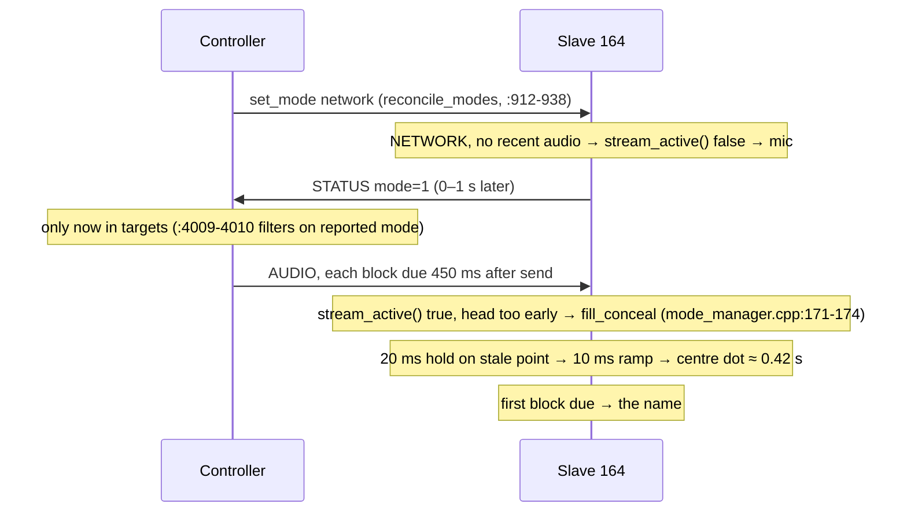

# Stream gaps on the scope: burst-start cleanup and loop-fill concealment

**Status:** Phase 1 and 1b implemented and bench-run on 164 (2026-10-14, §3.6–3.8); scope check
still open. Phase 2 implemented 2026-10-17: controller deployed, 164 flashed, §4.5 counter checks
pass (`STATUS.md`, "Phase 2"); its scope check is open too. Phase 3 implemented 2026-10-17 (§5):
150 ms loop-fill, and a flush mid-stream pre-rolls on the mic instead of the ladder (rev 6).
- Measurements: `src/unoq-controller/STATUS.md`, "Transmission to one node (164)".
- Normative wire spec stays `protocol.md` + `protocol.h`; this file says what will change in them
  and why.
- Tracks `PLAN.md` risk 5 (WiFi jitter/loss).

**Phases:**
- **Phase 1 (A)** and **Phase 2 (B)** are built and deployed to the controller and all three
  slaves (164, 100, 121; 100 and 121 flashed 2026-10-17).
- **Phase 3 (C)**: the gate data came in at three nodes (§9); built 2026-10-17, see `STATUS.md`
  "Review fixes and Phase 3" for what is flashed and measured.
- The loss diagnosis (§6) runs alongside and blocks nothing.
- Unresolved questions are in §9.

## 1. What the audience sees

Two artefacts, with different causes and different fixes:

| | When | Cause | Visible as |
|---|---|---|---|
| **A. Burst-start centre dot** | every logo/name burst, deterministic | **pre-roll**: the slave joins a stream whose blocks are due 450 ms after they are sent, and the "too early" path runs the concealment ladder | ≤ 20 ms on a stale point, a 10 ms glide, then a **centre dot for ~0.42 s** before the name |
| **B. Mid-figure sparkle** | ~2–7 times/s during play (1–3.5 % packet loss on 164, same for logos and names) | lost packet → 5 ms hole filled with copies of the last point | beam **parks on one spot for 5 ms** (bright dot) and that 5 ms slice of the drawing is skipped: 25–35 % of one redraw at 50–70 Hz |
| **C. Mid-burst centre dot** | 4.5–5.6 times per burst per node at three nodes, ~0.7 at one (2026-10-17) | a hole of 25–150 ms (AP queue refusals) is over the 20 ms fill limit, so the buffer flushes and the restart is due 450 ms out; the ladder runs meanwhile | 20 ms hold, 10 ms glide, then a **centre dot for ~0.4 s** mid-name: 12–26 % of stream time per burst (median) on 121 |

- **Not the cause:** the buffer running dry. Steady-state underruns were 0 and the controller's
  send queue lost nothing (`txfull`/`txerr` 0).
- **Not a fix:** a larger buffer. B is missing data, not late data.
- **Not the same event:** A and the one underrun per burst.
  - A comes from `pull_block` returning "too early" (`net_rx.cpp:378-381`), which counts no
    underrun.
  - `st_underruns` only moves on a failed `pop` (`net_rx.cpp:390-393`).
  - The underrun is a separate, still-unexplained event (§2.3).

## 2. Today's code paths

### 2.1 Lost packet (B)

`net_rx.cpp:117-138` judges continuity by deadline against the buffer tail:

- **1–20 ms past the tail:** `jb.push_hold(n)` appends `n` copies of the last pushed frame
  (`jitter_buffer.h:67-86`), then appends the packet.
- **More than 20 ms past:** `jb.reset()`, then rebuffer from this packet (60 ms start gate, then
  the pre-roll of §2.2).
  - **Invisible today:** after a reset `jb.started()` is false, so `pull_block` returns at
    `net_rx.cpp:374` before any `pop`, and **no counter moves**.
  - **Also invisible:** controller re-anchors (`hype_controller.py:4020-4024`) leave no trace on
    the slave.
  - "Underruns 0" therefore does **not** mean "no resets".
- **Earlier than the tail:** dropped as duplicate/reordered.

The fill happens at **push** time, ~450 ms ahead of the playhead, so everything a fill could copy
from is still in the ring.

### 2.2 Burst start (A): pre-roll, confirmed

- **The controller runs one continuous feed.** `epoch` is set once
  (`hype_controller.py:3945`, `epoch = start + LEAD_US`) and re-anchored only on > 20 ms drift.
  Every block is due 450 ms after it is rendered.
- **So the delay is built in.** A pattern switched at wall time *t* reaches the scope at
  *t* + 450 ms, however fast the node's mode flips. That is the design, not a defect.
- **What makes it visible** is what the slave draws while it waits:

**Evidence:**
- **On 164 today:** `src` reached 1 only 1.3–1.5 s after the pick. That is the 0–1 s STATUS lag
  plus the 450 ms lead. STATUS arrives once a second, so this number is only accurate to ±1 s.
- **In the code:** `pull_block` has only "play / don't play"; `fill_block` conceals whenever
  `stream_active()`.

### 2.3 One underrun per burst: refill (resolved by Phase 1)

- **Observed:** under +1 per burst, near the burst start, with `depth 0` and `src 0`, but only at
  1 Hz resolution.
- **Also observed:** after every burst, 164 reported `mode/src = 0,0` with a **non-zero** `depth`
  (13440, 10800, 6240, 4080, 1440 frames). LOCAL mode is buffering stream audio, because
  `handle_audio_packet` has no mode check.

**Candidate causes** (resolved 2026-10-14, §3.6: it was 1; 2 happens only on a lost command):
1. **Post-burst refill.**
   - `set_mode(LOCAL)` flushes (`mode_manager.cpp:118`), but the controller keeps sending until
     the next STATUS reports mode 0 (`:4009-4010`), and the buffer refills.
   - At the next NETWORK entry, `pull_block` skips the past-deadline blocks, plays the last one,
     then fails a `pop`.
   - This may not happen at all: if a new packet arrives first, the > 20 ms rule resets the
     buffer (`net_rx.cpp:131-134`).
2. **Burst-end drain.** The buffer empties while the slave is still in NETWORK, as the stream to
   it stops, and the next `pop` fails.

Phase 1 adds the logging that told these apart (§3.6).

## 3. Phase 1: clean burst start

### 3.1 Slave: a LOCAL slave never buffers stream audio

- **New gate.** `net_rx::set_accept_audio(bool)`.
  - `mode_manager::set_mode` calls it **before** the mode flips. Closing the gate also flushes
    (it replaced `net_rx::flush()`), in that order, so no packet can land after the flush.
  - On re-accept, also `jb.reset()` and clear `have_seq`. Otherwise the seq jump across a LOCAL
    stint under 5 s (< 1000 packets) counts as loss.
- **Initialise it in `init()` too.** `init()` sets `g_mode` directly (`mode_manager.cpp:84`).
  Boot-local keeps the radio off, so this is harmless today.
- **`handle_audio_packet`:** return right after the type check when not accepting, before the
  seq accounting and before the stats/liveness update. The rx/lost counters and
  `stream_active()` then describe only audio the slave would play.
- **Threading:** the flag is a `volatile bool`. It is written by the net task (CMD) or the loop
  task (console/button) and read by `async_udp`.
- **Status:** removed the per-burst underrun on the bench (§3.6).

### 3.2 Slave: pre-roll draws the local render, not the ladder

- **The difference to detect:** a fresh join (head far in the future) vs a mid-stream hiccup
  (head within a few ms). `pull_block`'s single bool cannot tell them apart; a state flag in
  `mode_manager` can.
- **`g_net_played`:**
  - set when `pull_block` succeeds;
  - cleared when the mode **actually changes** (`m != g_mode` in `set_mode`, not every call);
  - also cleared whenever `fill_block` sees `!stream_active()`. A Wi-Fi reconnect, unmuting after
    SILENT, or a controller restart (all > 1 s without audio) then gets a clean entry too.
- **`fill_block` NETWORK:**
  - `fill_conceal` only when `g_net_played`;
  - otherwise `renderer_local::render`, the same as the stream-lost branch.
  - The mic keeps drawing until the name's first block is due: a clean mic → name cut.
- **Scope: joins only.** A mid-name large-gap reset keeps today's ladder; Phase 2's counters
  show how often that happens.
- **Dashboard:** `active_source()` already reports 0 during this period.

### 3.3 Controller: stream targets follow the commanded mode

- **Change:** extract `stream_targets(state)` from the loop at `:4009`. If a `mode_sent` command
  is pending, its mode wins over the last reported mode. `reconcile_modes` already pops the entry
  once the report agrees (`:926`).
- **Start:** the stream starts when the network command is sent, saving the 0–1 s STATUS lag.
- **End:** the stream stops when local is commanded.
  - The command and the audio share the AP's queue to that slave, so audio sent before the
    command arrives first and is then flushed.
  - No post-burst tail, even for unflashed slaves.
- **If a command is lost** (2 of ~19 `local` commands on the 2026-10-14 bench, both at the end
  of a logos burst; §3.6):
  - *lost `network`*: no audio is accepted (gate closed) until the resend arrives.
  - *lost `local`*: the slave stays NETWORK while the stream to it has stopped, and its buffer
    drains. Phase 1 showed ~0.55 s of centre dot here; before 3.3 the same loss kept streaming
    the last pattern for up to 3 s.
  - Phase 1b (§3.7) answers both: resend every policy tick, an immediate STATUS reply so the
    resend rarely fires, and an underrun shows the mic instead of the dot.

### 3.4 On-air timing (consequence, decision deferred)

After 3.1–3.3, names air 450 ms after their step starts, because of the lead. What they lose
depends on what follows:

| sequence | first name | second name |
|---|---|---|
| A → mic pause | t+0.45 … t+5 (4.55 s) | — |
| A → B back to back (one stream) | t+0.45 … t+5.45 (full 5 s) | t+5.45 … t+10 (4.55 s) |

- **Only the step that ends on a flip to LOCAL loses 0.45 s:** the flip flushes the buffered
  tail.
- **Making it exact (optional):** switch the pattern `LEAD_US` before the step starts, and flip
  to LOCAL `LEAD_US` after it ends while that node's stream holds the step's pattern. That lives
  in the burst scheduler. It is out of Phase 1 unless 4.55 s reads as wrong on stage.

### 3.5 Phase 1 bench acceptance

- **Instrumentation** (stays in; it is how §2.3 got pinned):
  - the slave records mode changes, stream-up, first block played and each underrun /
    stream loss, with the ms since the mode change, in a 16-entry event ring;
  - the loop task prints them as `[ev <ms>] …` lines, **always** (a handful per burst; no
    `log on` needed), and `stat` shows the last pre-roll time.
  - Printing happens off the audio task, so I2S timing is untouched.
- **Flash 164, 10 bursts each of names and logos:**

| check | today | expected after |
|---|---|---|
| scope (phone video) at burst start | stale point → glide → centre dot ~0.42 s → name | mic → name, no centre dot |
| pre-roll time (serial) | not logged | ≈ 450–500 ms from mode entry |
| `depth` in LOCAL after a burst | 1440–13440 frames | 0 |
| underruns per burst (serial log) | 1 | the log says which §2.3 candidate it was; expect 0 if it was the refill |
| lost/s, drop/s in steady play | 1–3.5 %, 0 | unchanged |

- **`test_policy.py`:** `stream_targets` for pending-network, pending-local, settled and
  unknown-slave cases.

### 3.6 Bench result (2026-10-14, 164 on USB serial)

`/tmp/burst_probe.py`: turn 164's logos/artists on, play the artists pair 2 (trillosta → JEANS,
10 s) and the logo pair (8 s) from the API in turn, read the slave's `[ev]` lines, restore.

| | new slave, old controller (4 bursts) | new slave + new controller (5 bursts) |
|---|---|---|
| mode change → stream-up | 181–186 ms | 85–111 ms |
| stream-up → first block played | 456–576 ms | 575–596 ms |
| mode change → first block played | 637–762 ms | 671–692 ms |
| underruns | 0 | 1 — burst-end drain after a lost `local` command (journal shows it sent) |
| `depth` in LOCAL at the end | 0 | 0 |
| `drop` | 0 | 0 |

- **The per-burst underrun is gone** with only the slave gate in place: it was the post-burst
  refill (§2.3 candidate 1).
- **Stream-up → first play is ~580 ms, not the 450 ms lead:** a buffer reset during pre-roll at
  every join, found with the Phase 1b logging (§3.8). Not a clock error: the buffer holds only
  512 ms, so a 580 ms lead would have counted drops.
- **Scope not checked yet.** The mic-not-dot pre-roll follows from the code path
  (`g_net_played` false → `renderer_local::render`); the phone-video row of §3.5 is still open.
- Pending command → stream: `mode change → stream-up` went from 181–186 ms to 85–111 ms. The
  old figure is partly a probe artefact (each pick landed at the same point of 164's 1 Hz
  STATUS; in the show that lag is 0–1 s), so the gain is larger than it reads.

### 3.7 Phase 1b: after the Phase 1 review

- **Controller, `MODE_RESEND_US` 3 s → 200 ms:** an unconfirmed `set_mode` goes out again on every
  250 ms policy tick. A lost `network` used to cost 3.45 s of a 5 s name.
- **Slave, STATUS reply to every CMD** (`handle_ctrl_packet`): confirmation in one round trip,
  so the resend only fires on a real loss. Unflashed slaves confirm at their 1 Hz beacon and get
  ≤ 4 harmless duplicates per transition.
- **Slave, an underrun ends the playing state** (`g_net_played = false`): with a 450 ms lead the
  buffer only runs dry after ~0.45 s without packets, so the stream has stopped (lost `local`,
  SILENT mid-burst, controller crash). It shows the mic, not ~0.55 s of centre dot, and a
  restart is timed as a fresh join.
- **Controller, forward-only re-anchor above 100 ms, backlog dropped** (`REANCHOR_US`, also in
  `hype_sender.py` at half its 80 ms lead). Show night (Aug 21–22) had five re-anchors of 26,
  347, 28, 21 and 52 ms, each followed within 50 ms by a −20…−23 ms one: the > 20 ms forward
  jump reset every slave (~0.45 s of dot on all scopes), and the catch-up burst then
  overshot into a backward re-anchor whose ~4 packets the slaves dropped as duplicates. Now a
  stall ≤ 100 ms is caught up with the original deadlines (they still arrive ≥ 350 ms early);
  a longer one jumps the epoch once and sets `next_audio = now`, so there is no catch-up
  burst and no lead ratchet (a replay of the loop: 26/52/99 ms stalls → no jump, lead back
  to 450 ms; 347 ms → one forward jump). 4 of the 5 show-night events would have been
  invisible. A pause (SILENT) slides the epoch with the pacing clock, so resume is on
  schedule. This takes controller re-anchors off Phase 3's list.
- **Slave logging:** a `reset` event with the hole size and the restarting packet's lead, a
  `resets=` counter in `stat`; `stream-up` carries the first packet's lead; `first-play`
  and `preroll=` are timed from the join (stream-up or underrun), not the mode change.
- **Slave console never blocks:** `Serial.setTxTimeoutMs(0)` with a 1 KB TX ring. With USB
  plugged into a host that isn't reading, each write could wait up to 2 s (20 × 100 ms) and
  stall the loop task's LEDs, MODE button and battery cutout.

### 3.8 Phase 1b bench result (2026-10-14, 164 on USB serial)

Same probe, 5 rounds (10 bursts), then a burst with SILENT pressed 3 s in and released 2 s later.

| | per join (10 bursts) |
|---|---|
| mode change → stream-up | 80–111 ms |
| first packet's lead at stream-up | 262–336 ms (sent with 450) |
| buffer reset during pre-roll | **every join**: hole 90–180 ms, then lead 414–449 ms |
| stream-up → first play | 575–605 ms |
| `set_mode` sends per transition (journal) | 1 for all 20 burst transitions; the first `network` after the reflash went out twice, 1 s apart |
| controller re-anchors | 0 |

- **SILENT mid-burst:** underrun 0.5 s after the stream stopped, `stream-lost` 0.54 s later,
  no `first-play` in between, so the slave drew the mic, not the dot. On resume the stream
  rejoined like any join (lead 328 ms, a 105 ms hole, first play 676 ms after).
- **The first ~130 ms of every new flow to the slave arrives late, then ~90–180 ms of it is
  lost.** The controller printed no re-anchor and the seq gaps count it as lost packets, so it
  is in transit, between the UNO-Q's `sendto` and the slave's `async_udp` queue. Same after the
  2 s SILENT pause, so a short idle is enough to trigger it. [INFERENCE] Candidates: block-ack
  session setup on the AP holding the TID's frames, then releasing them as a burst; or that burst
  overflowing `async_udp`'s 32-deep queue (STATUS 2026-08 saw ~60-packet AP bursts do that).
  Cost today: none visible (the reset falls in pre-roll, which shows the mic), ~130 ms of extra
  latency per join. It also explains the old ~180 ms mode → stream-up.
- Final `stat`: rx=18876 drop=0 gaps=538 lost=1069 resets=12 underrun=2 (the SILENT test and a
  boot transient before the clock synced) depth=0.

## 4. Phase 2: loop-fill concealment

Every pattern the controller streams repeats exactly at 1/`freq`:

- **Text and figures** walk the table at `freq` redraws/s (`hype_controller.py:1325`).
- **Circle, Lissajous and rose** advance `p` by `2π·freq/48000` per sample (`:1358`).
- **Lissajous `a`/`b` and the rose petal count are integers 1–9** on both entry paths: the API at
  `:3611-3613` and `clean_preset` at `:162-163`. So all three repeat every 2π.

The samples a lost packet carried were therefore already sent one loop earlier. The slave fills
the hole by copying from one loop back in its own ring, in place of the parked point.

### 4.1 Wire format

`HypeAudioPayload.reserved` (u16, offset 26) becomes **`loop_frames`**:

- the pattern's repeat length in **whole frames at 48 kHz**;
- **0 = no usable loop** → today's last-value hold.

| freq | loop_frames | rounding |
|---|---|---|
| 50 Hz | 960 | exact |
| 55 Hz | 873 | +0.27 |
| 60 Hz | 800 | exact |
| 70 Hz | 686 | +0.29 |

- **Range:** a u16 covers down to 0.73 Hz; the ring bound (§4.3) is the real limit.
- **Precision:** the weakness of whole frames is at **high** freq, where §4.2 rounding drift
  rules it out.
- **Senders:**
  - Only `hype_controller.py` writes the field.
  - `hype_sender.py:154` and `mcast_probe.py:83` keep sending 0 (hold); they are test tools.
- **Compatibility:** current slaves ignore the field (`protocol.md` §9). No version bump.

| controller | slave | result |
|---|---|---|
| old (sends 0) | new | hold, as today |
| new | old (ignores) | hold, as today |
| new | new | loop-fill |

### 4.2 Controller: what goes in the field

A pure helper (unit-tested in `test_policy.py` style) owns the decision. It is called once per
packet in the stream loop.

Definitions:
- `P = 48000 / freq` (exact loop length);
- `L = round(P)` (what goes on the wire);
- `F` = the controller's fill ceiling in frames (`LOOP_FILL_CEIL`, below).

**Send `L` only when all of these hold; otherwise send 0:**
1. **No spin:** `rot_speed == 0`. Spin breaks periodicity. The slider is disabled, but presets
   and `/api/pattern` can still set it.
2. **Integer ratios** (always true today, kept as a guard).
3. **Ring bound:** `1 ≤ L ≤ LOOP_MAX_FRAMES` = 8192 (≈ 5.9 Hz).
4. **Rounding drift:** a fill copies forward loop by loop, so the rounding error accumulates.
   Require `ceil(F / L) · |L − P| ≤ 4` frames.

   | freq | drift at F = 150 ms (7200 frames) | result |
   |---|---|---|
   | 55 Hz | ≈ 2.5 frames | passes |
   | 70 Hz | ≈ 3.1 frames | passes |
   | 50 / 60 Hz | 0 | passes |
   | 700 Hz (68.57 frames) | ≈ 45 frames, two-thirds of a loop | rejected |

5. **Pulse:** the size change across one loop is `pulse_depth · π · pulse_rate / freq`. Require
   it ≤ 5 %.
   - The sliders allow 10 Hz at 100 % depth, which gives 57 % at 55 Hz.
   - The eight show presets give 0.0–2.6 % (HyperLili 0.25 at 2 Hz / 60 Hz).
   - Over a whole hole the step is `depth · π · rate · (hole + loop) / 48000`. For a 2-packet
     hole that is 4.2 % at HyperLili and ≤ 2.9 % for the other seven. Longer fills are a Phase 3
     input.

**Settle window after any change.**
- **Why the controller must decide:**
  - The slave cannot see pattern changes: the controller never sets SYNC_PULSE (`:4027` sends
    flags 0).
  - The artists mostly share 55–60 Hz, so the loop length often doesn't change either.
- **Rule:** send **0 for `L + F` frames** after any change of the `pattern_params()` tuple
  (`:1231`): kind, freq, amp, a, b, table *identity*, rmax, pulse, rot, flips.
- **Why that long:** a packet arriving after a hole of up to `F` copies from up to `L + F` frames
  before itself. That source must post-date the change.
- **What it covers:** preset loads, cycle steps, SIZE, freq drags, text/font edits and flips.

**One fill limit, set by the controller.**
- `LOOP_FILL_CEIL` = 150 ms from Phase 2 onward, even though Phase 2 slaves fill at most 20 ms.
- **Why:** the controller is a single deploy over the tether, while each slave needs USB. If a
  slave that fills up to *X* ms ever met a controller whose settle window assumed less, a hole
  near a pattern change would be filled with the old pattern.
- **Cost:** a bit more hold time after each change.
- **Invariant:** `LOOP_FILL_CEIL` (controller) ≥ `HYPE_LOOP_FILL_MAX_MS` (`protocol.h`, the slave
  limit, 20 in Phase 2). A controller test parses `protocol.h` and asserts it.
- **If the limit ever goes up:** the controller is deployed first.

**Cost:** one tuple compare plus a few float ops per 5 ms block.

### 4.3 Slave: `JitterBuffer::push_loop(count, loop)`

- **Commit protocol:** the same as `push_hold`. Snapshot epoch/tail under `mux_`, copy, then
  commit only if the epoch is unchanged.
- **Copy forward one frame at a time** from `(tail + CAP − loop + i) % CAP` to `(tail + i) % CAP`.
  - **Index:** `CAP` = 24576 is not a power of two, so `(tail − loop + i) % CAP` underflows
    uint32 to the wrong index.
  - **Overlap:** when the hole is longer than a loop (60 Hz: 800 frames vs a 4-packet hole of
    960), the copy reads frames it wrote earlier in the same call, like LZ77.
    `memcpy`/`memmove` would read stale ring contents.
- **`pushed_since_reset_` is a `JitterBuffer` member:**
  - zeroed inside `reset()`'s critical section, and by a `push` onto an empty buffer (added
    2026-10-17 after review): after an underrun the next packet re-anchors without `reset()`,
    and the ring still holds the stream from before the stall;
  - incremented inside the **same** critical section that commits the tail, for `push`,
    `push_hold` and `push_loop`.
  - `reset()` is reachable from another task (`set_mode` → `flush`). A counter held anywhere
    else could race a flush and report a stale count, and the fill would copy invalid data.
- **Validity, checked before choosing loop over hold:**
  - `loop != 0`;
  - `pushed_since_reset_ ≥ loop`: data from before a reset belongs to an older stream;
  - `loop + count ≤ CAP − 1`: the source never overlaps this fill's own write window.
- **After the fill:** `last_l_/last_r_` = the last filled frame, so a later hold continues from the
  right point.
- **Caller:** in `net_rx.cpp:122-126`, use `loop_frames` from the packet *after* the hole. It
  describes the content around the hole, and §4.2 zeroes it whenever the source would be stale.

### 4.4 Observability and bench tooling

**Counters.** Phase 3 needs these, and right now resets are invisible (§2.1).

| counter | counts |
|---|---|
| `loop_fills`, `hold_fills` | fill events, by method |
| `gap_resets` | > limit gaps that reset the buffer |
| `reanchor_gaps` | deadline jumps with **contiguous** seq: a controller re-anchor, nothing lost |
| gap-size histogram | holes of 1, 2, 3–4, 5–30, > 30 packets |

- **Where they show:** in `stat` (`ui.cpp:192`), and appended to STATUS after `lost_packets` as
  nine u32: payload 39 → 75 B, datagram 59 → 95 B.
- **Controller:** parses them length-tolerantly, like `lost`. The dashboard shows a fill line per
  slave, and `/api/state` carries the histogram.

**Console commands** (RAM only):
- **`droptest <every> [run]`:** drop `run` consecutive AUDIO packets every `every`, *before* the
  seq accounting, so they count as real loss. `droptest 0` turns it off.
- **`fill loop|hold`:** force either method, for A/B on the same scope.
- **`log on`:** also prints one line per fill event (method, size, ms since the last pattern
  change seen as a 0 field). §4.5 can then check the settle window without luck.

**Host test (prerequisite: a build path).** The slave has only the `esp32c3-supermini` env and
no test infrastructure.
- **Build:** `src/esp32-slave/test/host/test_jitter_buffer.cpp`, built with one documented `g++`
  command against a small shim for `portMUX_TYPE`/`portENTER_CRITICAL`.
- **The race needs a hook:** the shim's critical-section macro calls a test hook once. A
  single-threaded test can't hit a reset racing a fill any other way.
- **Cases:**
  - hole longer than a loop (the LZ77 overlap);
  - ring wrap with `tail < loop` (the index formula);
  - `pushed_since_reset_ < loop` → hold;
  - reset injected between snapshot and commit → no commit, counter 0;
  - the `loop + count` bound.
- **If the shim proves awkward:** fall back to on-board verification, via `droptest`, the
  counters and the scope. That is the acceptance below either way.

### 4.5 Phase 2 bench acceptance

| check | setup | expected |
|---|---|---|
| dot gone | bench scope, `droptest 20` (5 %), `fill loop` | no dots, no missing slices; `loop_fills` climbs, `hold_fills` ≈ 0 |
| A/B | same, `fill hold` | dots back; `hold_fills` climbs |
| settle window | `droptest 2`, then preset changes | the per-event log shows hold only within `L + F` of each change, loop everywhere else |
| no-loop patterns | `rot ≠ 0`, or pulse 10 Hz / 100 % | field 0, hold only |
| rig | 164, all eight presets, normal loss | same counters; lost/s unchanged (this conceals, it does not cut loss) |

## 5. Phase 3: raise the reset limit (implemented 2026-10-17)

- **Before:** any gap over 20 ms reset the buffer, followed by ~0.45 s of the ladder for
  mid-stream gaps. Hold-fill made 20 ms the right limit, because a longer parked dot is worse
  than a reset. Loop-fill removes that reason.
- **The gate data** (three nodes, 2026-10-17, `STATUS.md` "Three-node stress soak" and the
  second one): 4.5–5.6 resets per burst per node, 94 % of them holes of 5–30 packets (25–150 ms),
  each ~0.4 s of centre dot on the scope (artefact C, §1). One node: 0.7 per burst, mostly join
  holes during the pre-roll, invisible.
  - **Why the node count mattered:** on 2026-08-09, with three nodes, the controller lost
    1–29 % of packets before they reached the air, in bursts timed with the deaf-stall clusters.
  - **A deaf window delays packets; it doesn't lose them.** Its length (~103 ms, STATUS
    2026-08-04) is not by itself an argument for any limit.
- **What was built:**
  - `HYPE_LOOP_FILL_MAX_MS` = 150 ms (`protocol.h`) = the controller's `LOOP_FILL_CEIL` (§4.2),
    so no controller change; `test_loop.py` still asserts ceiling ≥ slave limit.
  - **Hold stays at 20 ms** (`HOLD_FILL_MAX_MS`, `config.h`): with no usable loop (field 0 in a
    settle window, too little history, `fill hold`), a 25–150 ms hole still flushes.
  - **A flush mid-stream pre-rolls on the mic**, not the ladder (`mode_manager.cpp`, the audio
    task watches `net_rx::flush_count()`): the restart is due 450 ms out, the same wait as a
    join (§3.2). Covers SYNC_PULSE and WiFi-reconnect flushes too.
- **Decisions on the constraints:**
  - **Pulse step over a long fill: accepted.** At HyperLili a 150 ms fill ends with up to a 26 %
    size step at the steepest point of the pulse; one step beats 0.4 s of dot. The slave can't
    cap by pulse rate (it never sees the pulse), and zeroing the field for HyperLili would turn
    its 25–150 ms holes back into resets and its ≤ 20 ms ones into holds.
  - **Re-anchors:** with seq contiguous, nothing is missing, so loop-fill **inserts** drawing.
    The next packet resumes out of phase by (drift mod loop). That is one visible jump, much
    better than a 0.45 s reset. `reanchor_gaps` counts them.
  - **Ring room:** a hole of H ms arrives with the buffer at ~(450 − H) ms deep, leaving
    ~62 + H ms free in the 512 ms ring, so a fill of H always fits.
- **Acceptance:** `droptest 200 30` (the 5–30 bucket's worst, 150 ms) on a steady preset →
  `gap_resets` stays 0, `loop_fills` climbs, and the figure stays intact on the scope; a
  three-node soak shows the dark time per burst (`soak.py analyze`, `dark`) near the one-node 0 %.

## 6. Alongside: where is the loss?

This blocks no phase; it decides whether the loss itself can be cut.

- **AP counters can't answer it.**
  - On 2026-10-14, `iw dev wlan0 station dump` (`/sbin/iw`, not on the ssh PATH) showed
    `tx retries 0, tx failed 0` for 164 over 49,166 sent packets, while 164 counted ~2.5 % lost.
  - **[INFERENCE]** ath10k does not populate these counters.
  - `hostapd_cli` is not installed.
- **Air vs ESP32:** use the 2026-08-04 laptop station rig (`wlp61s0`, NM profile `HYPEROSCI_AP`,
  autoconnect off). The laptop runs a seq-numbered receiver for `mcast_probe.py` while the
  controller streams to 164.
  - Loss at the same moments on both → AP/air.
  - Loss on 164 only → the ESP32 receive path.
- **If it's the ESP32:** larger Wi-Fi RX buffers via pioarduino `custom_sdkconfig`. The real risk
  is replacing the prebuilt Arduino libs everything was validated on, more than the effort.

## 7. Considered and not chosen

| Option | Why not |
|---|---|
| Straight line across the hole | A line drawn over 5 ms dwells long, so it is bright. It cuts through the logo, which is no better than the dot. |
| XOR parity (1 per N) | Needs interleaving for back-to-back losses. Needs overwrite-in-place (a late repair is dropped as a duplicate at `net_rx.cpp:127`). Must be a new packet type, or old slaves draw the parity bytes. +1/N airtime on a link the N × 263 pkt/s rule already limits. Its exact repair buys nothing for periodic content. |
| NACK / resend | The request travels the same stalled link. Round trips hit 0.5–1.7 s during the rate-control wedge. |
| Bigger buffer / longer lead | The holes are lost data, not late data. |
| Multicast audio | Measured and rejected (STATUS 2026-07-31): no link-layer retries. |

## 8. Docs and code to update as each phase lands

- **`protocol.h`:**
  - `loop_frames`;
  - the STATUS counters and new size asserts;
  - `HYPE_LOOP_FILL_MAX_MS`.
- **`protocol.md`:**
  - §3.1: `reserved` → `loop_frames`; whole frames, 0 = hold, which senders set it.
  - §3.4: 95 B datagram, still accept ≥ 55; the new fields.
  - §5.2: the gap row chooses loop-fill vs hold.
  - §6: the ladder applies only after a block has played; pre-roll draws the local render.
  - §7.2 diagram.
  - §11 constants.
  - **SYNC_PULSE:** §5.4 says the controller sets it on preset changes, and §10 (`:508`) says to
    set it on packet 0 of every new epoch. The controller does neither. Rewrite both to say it is
    **not** sent, and that a re-anchor must **not** set it: setting it would turn every re-anchor
    back into a reset.
- **`firmware/esp32-architecture.md`:** push-side and pop-side bullets.
- **`ui.cpp` help text:** `droptest`, `fill`, the extra `log on` lines.
- **`src/unoq-controller/STATUS.md`:** one entry per deployed phase, with before/after counters.
- **Flashing:** every slave needs USB. Unflashed slaves keep working (§4.1); only 3.3 helps them.

## 9. Open items

| Item | Status | How it closes |
|---|---|---|
| Cause of the one underrun per burst (§2.3) | **closed**: post-burst refill; fixed by the LOCAL gate (§3.6) | — |
| Lost `local` command → ~0.55 s centre dot (§3.3) | **fixed in Phase 1b** (§3.7): 200 ms resend, STATUS reply per CMD, underrun → mic | scope check below |
| Stream-up → first play ≈ 580 ms vs 450 ms lead (§3.6) | **explained** (§3.8): a pre-roll reset at every join | — |
| Late + lost start of every new flow (§3.8) | measured, cause not pinned | log arrival time, seq and lead of each packet in a join's first 300 ms on the slave; check `async_udp` queue overflow vs AP release |
| Do these joins need concealment? | Phase 3 built (§5) | join holes of 90–180 ms now loop-fill when this packet's field is set; a hole inside the settle window after the burst's pattern change (field 0) still resets, invisibly (pre-roll shows the mic). Check `preroll=` and the `[ev]` resets on one flashed node |
| Scope check of Phase 1 / 1b (§3.5) | open | phone video of a burst start (mic → name, no dot) and of SILENT pressed mid-burst (mic, no dot) |
| Scope check of Phase 2 (§4.5) | counters pass on 164 (2026-10-17, `STATUS.md`); scope open | `droptest 20` with `fill loop` vs `fill hold` on the scope or the XIAO capture: no dots vs dots |
| Air vs ESP32 loss (§6) | open | laptop comparison |
| STATUS 2026-08-04 "zero tx retries, zero tx failed" | rests on counters ath10k likely leaves at 0; the 1139 pkt/s receiver-side result stands | mark that line "not populated by ath10k", not "clean link", once §6 confirms |
| Phase 3 limit | **set to 150 ms** (§5). Data (2026-10-17, `STATUS.md` "Three-node stress soak"): at three nodes 5.6 resets per burst per node, 94.7 % of them holes of 5–30 packets (25–150 ms); one node: 0.7 per burst, half of them 5–30. Each mid-stream reset cost ~0.4 s of centre dot (first misread as ~39 ms; corrected in `STATUS.md` "Review fixes and Phase 3") | three-node soak on the new firmware: `gap_resets` and `dark` per burst |
| Exact on-air timing (§3.4) | deferred | decide after seeing Phase 1 on stage |
| Move off the onboard AP to a router? | **decided 2026-10-14: no.** The show stays on the UNO-Q's onboard AP (`hyperosci-ap`); loss work targets that AP and the ESP32 | closed |
